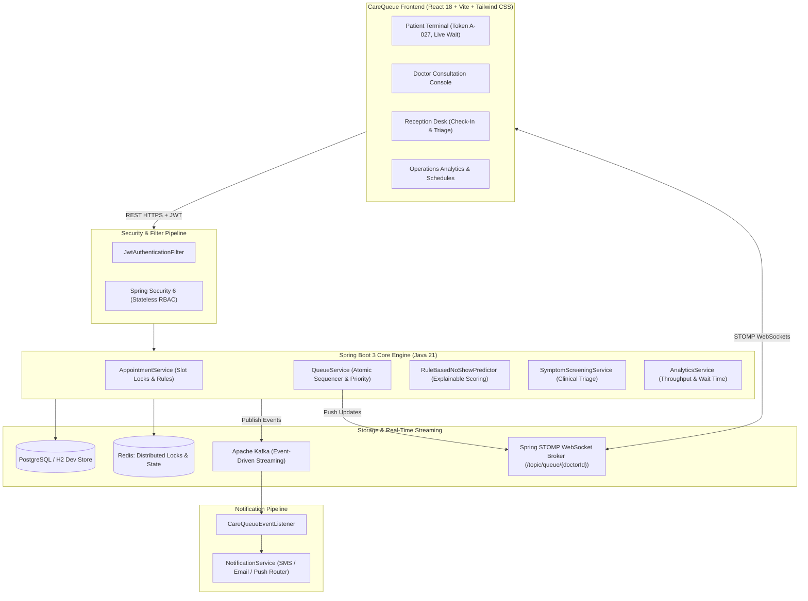

# CareQueue — Production-Grade Smart Hospital Queue & Appointment Operations Platform

[](https://www.oracle.com/java/)
[](https://spring.io/projects/spring-boot)
[](https://reactjs.org/)
[](https://tailwindcss.com/)
[](https://www.postgresql.org/)
[](https://redis.io/)
[](https://kafka.apache.org/)
[](LICENSE)

> **CareQueue** is a production-style, full-stack hospital operations platform connecting **Patients → Reception Desk → Attending Physicians → Hospital Administration** into a unified, low-latency, real-time workflow. Built specifically for high-concurrency clinical environments where duplicate tokens, double-booked slots, or unprioritized emergency trauma cases cannot be tolerated.

---

## 1. Executive Summary & Core Product Idea
In modern hospital clinics, uncoordinated scheduling leads to hours of agonizing waiting for patients, unpredictable physician schedules, high no-show rates, and chaotic reception desks. 

CareQueue transitions medical operations from fragmented spreadsheets and static appointments into an **Active Real-Time Event-Driven Hospital Operations Engine**:
1. **Patient**: Books slots via a multi-step clinical wizard, receives guaranteed atomic tokens (e.g. `A-027`), tracks people ahead and estimated wait times in real-time without refreshing.
2. **Reception**: Fast arrival check-in, walk-in token issuance, doctor schedule oversight, and one-click **Code Red Emergency Triage** (`E-xxx`).
3. **Physician Console**: Ergonomic clinical console with rapid consultation lifecycle (`CALL NEXT` → `START` → `COMPLETE` / `SKIP` / `NO-SHOW`), clinical observations, and diagnosis logging.
4. **Hospital Administration**: Live executive metrics, average wait time analytics, department workload charts, and physician shift utilization.

---

## 2. Dark Enterprise Healthcare Interface
The UI is strictly engineered with a **restrained dark healthcare palette** designed for operational clinical focus:
- **Application Root**: `#0B0E14` (deep charcoal, near-black)
- **Clinical Surfaces**: `#141A24` (sidebar, topbar, primary tables)
- **Elevated Surfaces**: `#1A2230` (modals, dropdowns)
- **Borders & Dividers**: `#242E42` (subtle structural outlines)
- **Accents**: Clinical Cyan (`#0EA5E9`) for primary tokens, Emerald (`#10B981`) for completed visits, Amber (`#F59E0B`) for warnings/locks, and Crimson (`#EF4444`) strictly reserved for Emergency Code Red states.
- **Zero AI-Generated Clutter**: No floating decorative blobs, no 3D illustrations, no marketing hero sections, no glowing neon cards.

---

## 3. High-Level System Architecture



---

## 4. Key Engineering Highlights & Placement Talking Points

### 1. Concurrent Token Generation & Zero-Collision Guarantee
- **The Problem**: Simultaneous bookings by hundreds of patients during morning peak hours causes duplicate tokens or deadlocks in standard auto-increment schemes.
- **Our Solution**: 
  1. Distributed slot locking with Redis `SETNX` (10s lease time).
  2. Striped JVM-level synchronization per doctor and schedule date.
  3. Relational ACID safety net: `CONSTRAINT uk_doctor_date_token UNIQUE (doctor_id, schedule_date, token_number)`.
  4. Verified by multi-threaded unit test `ConcurrentTokenGenerationTest` running 10 parallel threads with zero collisions.

### 2. Backend Relational Emergency Priority Mechanism
- **The Problem**: Emergency cardiac or trauma cases cannot wait behind routine checkups, and client-side sorting creates race conditions and UI desynchronization.
- **Our Solution**: Emergency requests allocate `E-xxx` tokens with `priority_rank = 1` (CRITICAL), while routine visits receive `priority_rank = 3` (NORMAL).
- **Ordering Query**:
  ```sql
  SELECT q FROM QueueEntry q
  WHERE q.doctor.id = :docId AND q.scheduleDate = :date AND q.status = 'WAITING'
  ORDER BY q.priorityRank ASC, q.tokenNumber ASC
  ```
  When the doctor calls the next patient, Rank 1 patients deterministically jump ahead of all existing tokens, regardless of arrival timestamp.

### 3. Asynchronous Event-Driven Architecture (Kafka)
- Decouples appointment booking and queue advancement from external delivery channels.
- Emits structured events:
  - `AppointmentBookedEvent`
  - `AppointmentCancelledEvent`
  - `TokenCalledEvent`
  - `QueueDelayedEvent`
  - `EmergencyAlertEvent`
- Notification consumer routes payloads to extensible SMS, Push, and Email abstractions (MSG91, Twilio ready).

### 4. WebSocket Live Queue Synchronization
- STOMP message brokering over `/ws`.
- Topics:
  - `/topic/queue/{doctorId}`: Broadcasts full doctor queue transitions.
  - `/topic/patient/{patientId}`: Sends urgent "TOKEN CALLED" push alerts to the specific patient device.
- Zero client-side polling required.

### 5. Clinical AI Symptom Pre-Screening Guardrails
- Patient describes: *"Severe chest pain radiating to left arm with sweating"*.
- Returns:
  - Suggested Department: **Emergency & Critical Care**
  - Urgency Level: **Emergency**
  - Clinical Reasoning & Doctor Questions
  - **Strict Guardrail**: NEVER prescribes medications or dosages; displays mandatory disclaimer: *"This is not a medical diagnosis. Please consult a qualified healthcare professional."*

### 6. Explainable No-Show Risk Engine
- Calculates risk scores (0–100) and risk tiers (`LOW`, `MEDIUM`, `HIGH`) based on historical unexcused absences, cancellation rate, lead time (>14 days), and slot timing (<08:30 or >18:00).
- Exposes risk flag to receptionists to optimize clinic overbooking strategies.

---

## 5. Seed Credentials & Demo Access

| Role | Email | Password | Pre-loaded Context |
| :--- | :--- | :--- | :--- |
| **Patient** | `patient@carequeue.com` | `Patient@123` | John Doe — Token `A-027` (6 ahead, 35 min wait) |
| **Physician** | `doctor.smith@carequeue.com` | `Doctor@123` | Dr. Robert Smith, MD (General Medicine, Room 104) |
| **Receptionist** | `reception@carequeue.com` | `Reception@123` | CityCare Front Desk (Check-In & Emergency Intake) |
| **Hospital Admin** | `admin@carequeue.com` | `Admin@123` | Hospital Operations Director (Executive Analytics) |

*(A quick one-click Demo Switcher is embedded directly on the Login page and Topbar for instant role switching during placement evaluations.)*

---

## 6. Local Quickstart (Zero-Friction Dev Mode)

The backend features a **dual-profile architecture**:
- In local development mode (`dev` profile), it uses high-performance in-memory PostgreSQL compatibility mode with embedded fallbacks, allowing you to run the complete system with **zero external software prerequisites**!

### Prerequisites:
- **Java 21 LTS**
- **Node.js 18+** & **npm**

### Step 1: Start Backend Server
```bash
cd backend
./mvnw clean compile
./mvnw spring-boot:run
```
*Backend runs on `http://localhost:8080` with H2 console at `/h2-console`.*

### Step 2: Start Frontend Application
```bash
cd frontend
npm install
npm run dev
```
*Frontend runs on `http://localhost:5173`.*

---

## 7. Production Docker Deployment
```bash
docker-compose up -d --build
```
This provisions:
- `carequeue-backend` on port `8080`
- `carequeue-frontend` on port `3000`
- `carequeue-postgres` on port `5432`
- `carequeue-redis` on port `6379`
- `carequeue-kafka` on port `9092`
- `carequeue-zookeeper` on port `2181`

---

## 8. Placement Interview Q&A Guide (2027 Resume Readiness)

### Q1: Why did you choose Redis for this hospital system?
> **Answer**: In CareQueue, Redis serves two distinct operational functions:
> 1. **Distributed Slot Locks**: Prevents race conditions when multiple patients attempt to book the same appointment slot simultaneously using `SET key value NX EX 10`.
> 2. **Current Queue State Cache**: Offloads high-frequency reads (`/api/queue/doctor/{id}`) from the PostgreSQL database as patients continually monitor their position.

### Q2: How do you prevent duplicate tokens under concurrent traffic?
> **Answer**: We employ a three-tier model:
> 1. Distributed lock on `lock:token-gen:{doctorId}:{date}`.
> 2. Striped in-memory reentrant locking to synchronize requests per doctor and date.
> 3. Database unique constraint on `(doctor_id, schedule_date, token_number)` as an ACID safety net, verified by multi-threaded JUnit integration tests.

### Q3: How is emergency priority implemented?
> **Answer**: Emergency priority is strictly handled on the backend through a relational priority ranking attribute (`priority_rank = 1` for Emergency, `3` for Normal). The repository orders waiting patients by `ORDER BY priorityRank ASC, tokenNumber ASC`. When a physician triggers `callNextPatient()`, emergency patients deterministically jump to the head of the queue ahead of earlier scheduled appointments.

### Q4: Why use Kafka instead of synchronous REST for notifications?
> **Answer**: Patient communication (SMS/Email/Push) depends on third-party carrier gateways that have unpredictable latency (500ms–3000ms) or occasional downtime. By streaming `AppointmentBookedEvent` and `TokenCalledEvent` to Apache Kafka, the appointment booking transaction completes in <50ms without blocking the user, while notification consumers handle delivery and retries asynchronously.