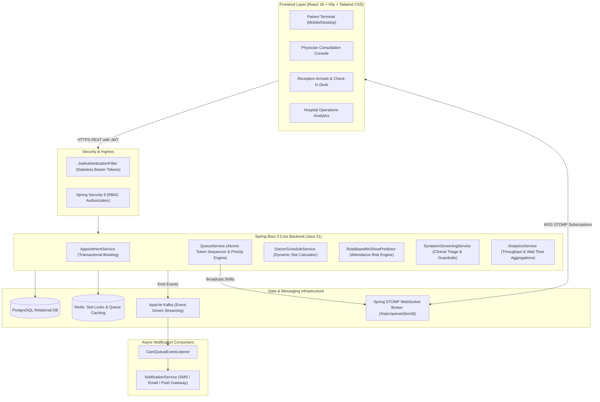

# CareQueue — Technical Architecture & System Specification

## 1. System Overview & Core Philosophy
CareQueue is a production-grade hospital queue and appointment operations platform connecting **Patients, Receptionists, Physicians, and Hospital Administration** into one unified, real-time clinical workflow.

Unlike generic scheduling dashboards, CareQueue addresses mission-critical healthcare realities:
- **Zero Token Collisions**: Under concurrent booking surges, two patients can never be assigned duplicate tokens.
- **Strict Backend Queue Priority**: Emergency patients (`E-xxx`) deterministically leapfrog regular scheduled appointments (`A-xxx`) based on database-enforced priority ranking (`priority_rank = 1` vs `3`).
- **Event-Driven Asynchronous Decoupling**: Critical events (`AppointmentBooked`, `AppointmentCancelled`, `TokenCalled`, `EmergencyAlert`) are streamed across Apache Kafka topics to isolate booking operations from SMS/Email/Push notification latency.
- **Bi-Directional Real-Time Synchronization**: Spring WebSocket with STOMP message brokering pushes live queue advancements directly to clinic terminals and patient devices without polling.
- **Explainable Clinical AI Guardrails**: Clinical symptom pre-screening strictly enforces non-diagnostic boundaries, refusing medication prescription while guiding patients to appropriate clinical specialties.

---

## 2. High-Level Architecture Diagram

---

## 3. Role-Based Access Control (RBAC)
The platform enforces strict role-based separation:
- `ROLE_PATIENT`: Access only personal appointments, personal live queue tracker, booking wizard, and AI pre-screening.
- `ROLE_DOCTOR`: Physician station controls (`call-next`, `start`, `complete`, `skip`, `no-show`), queue inspection, and clinical consultation records.
- `ROLE_RECEPTIONIST`: Physical arrival check-in, walk-in token allocation, and Code Red Emergency priority intake.
- `ROLE_ADMIN`: Hospital-wide throughput analytics, department performance, doctor utilization, and system audit logs.

---

## 4. Technology Stack Justification
| Layer | Technology | Engineering Rationale |
| :--- | :--- | :--- |
| **Language** | Java 21 LTS | Virtual threads readiness, sealed classes, pattern matching, strong memory model for high-concurrency systems. |
| **Framework** | Spring Boot 3.3.x | Enterprise ecosystem standard, mature transaction management, native metrics, first-class WebSocket & Kafka support. |
| **Relational DB** | PostgreSQL 16 | ACID transactions, strict unique constraints, relational normalization, JSON indexing. |
| **Distributed Lock & Cache** | Redis 7 | Sub-millisecond atomic key-value operations (`SETNX`), TTL-based slot locking, distributed state coordination. |
| **Message Streaming** | Apache Kafka | Durable partitioned event logs, pub-sub isolation of notification workflows, zero message loss. |
| **Real-Time Push** | Spring WebSocket (STOMP) | Low-overhead bi-directional messaging, topic subscriptions per doctor terminal, fallback via SockJS. |
| **Frontend** | React + Vite + Tailwind CSS | High rendering performance, component composition, strictly enforced operational dark enterprise styling. |